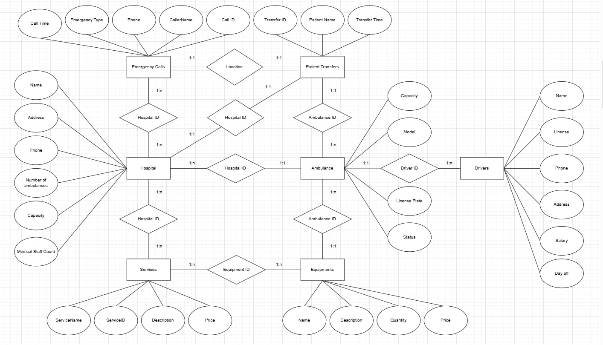
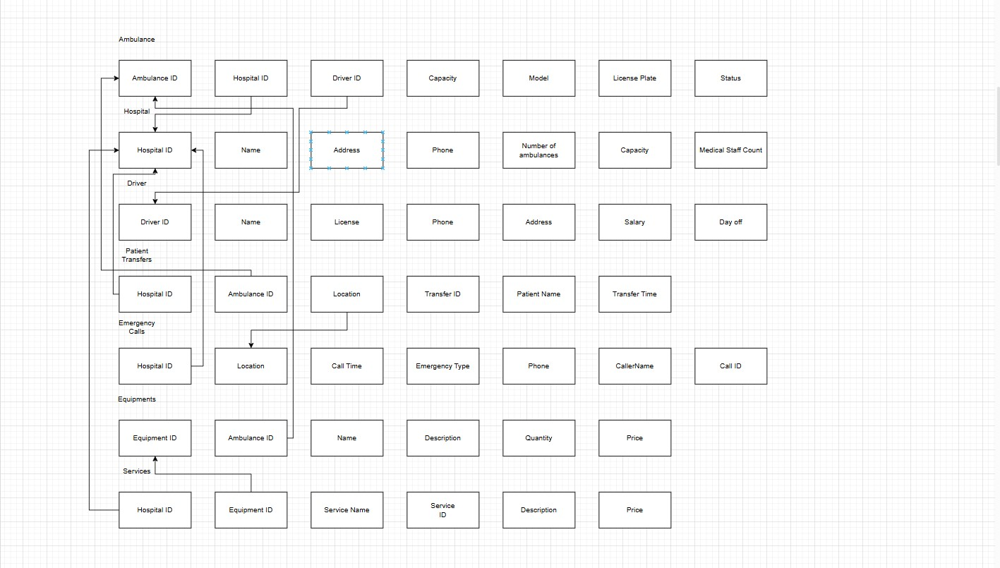

# Ambulance Service Database (SQL Server)

A relational database for an ambulance service: hospitals, drivers, ambulances, equipment, emergency calls, patient transfers and billed services. Designed from an ERD down to T-SQL scripts.

## Design

| ERD | Relational model |
|---|---|
|  |  |

Tables: `Hospitals`, `Drivers`, `Ambulances`, `Equipments`, `EmergencyCalls`, `PatientTransfers`, `Services`, `CustomerSpending`.

## Scripts (`AMBULANCE/sql_database`)

| File | Purpose |
|---|---|
| `Ambulance_table.sql` | Creates the database and tables |
| `Ambulance_table_extra.sql` | Extended version of the schema |
| `Ambulance_insert.sql` | Sample data |
| `Ambulance_features.sql` | Queries: customer feedback, service pricing, income versus costs, patient status, customers who spent over $1000 |

Run the scripts in that order in SQL Server Management Studio.
